# 2dbench

**An open, fair benchmark for 2D web renderers.** Every library draws the same scenes from the same simulation. Nothing is timed until a pixel-parity gate confirms every library drew the same thing. Every result carries the full environment it ran in, and every number can be re-derived from raw per-round data.

Renderer benchmarks are easy to rig, usually by accident: a library left on a slow default, scenes that favour one design, timing that vsync hides, numbers from one lucky run. 2dbench is built so that's hard to do and easy to check.

> **Conflict of interest, in the open.** 2dbench was started by the [debuff](https://debuff.jp) project, whose renderer [spryte](https://github.com/debuffjp/spryte) is one of the contestants. The parity reference is PixiJS `Sprite`, the most widely used 2D web renderer, not spryte. Every library's setup is documented, and library maintainers are invited to review theirs ([CONTRIBUTING](CONTRIBUTING.md)). If your library is configured badly, please send a PR.

**Status: early.** Ten scenes and nine adapters across spryte, PixiJS, Phaser and Canvas 2D, measured so far on desktop and laptop GPUs, iPhones and an Android phone. **Your device would help:** see [Submit your results](#submit-your-results), and the [community results](https://debuffjp.github.io/2dbench/results.html). Phone and other-browser results are the most wanted contribution.

## Results so far

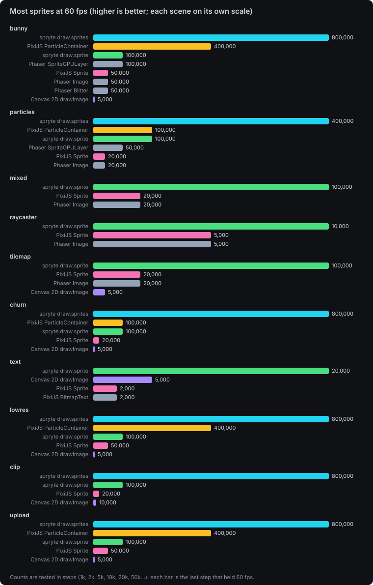

Windows 11, Chrome 155, NVIDIA RTX 5060 Laptop GPU (ANGLE, Direct3D 11), AMD Ryzen 7 260, on AC power with power plan Turbo, 23 October 2026, spryte 0.4.2, PixiJS 8.22.0, Phaser 4.2.1. The median frame (simulation through GPU completion) is in ms; lower is better. † marks frames under 2 ms, which are low precision ([why](METHOD.md#statistics)). Raw data, with every round's value, is in [`results/`](results); the spryte 0.2.1 runs these replace are in [`results/archive/`](results/archive).

### Across devices

`particles`, one draw call per sprite (spryte `draw.sprite` against PixiJS `Sprite`), every property changing. Most sprites held at 60 fps, and how much faster spryte's frame was at 50k sprites (10k on the Android phone):

| Device | GPU | Browser | spryte | PixiJS | spryte faster |
| --- | --- | --- | --- | --- | --- |
| Laptop (reference) | NVIDIA RTX 5060 | Chrome 155, Windows | 100,000 | 20,000 | 3.7x |
| Lenovo Legion Pro 7 | NVIDIA RTX 4080 | Chromium 156, Linux | 100,000 | 50,000 | 2.7x |
| Windows laptop | AMD Radeon 780M (integrated) | Chrome, Windows | 50,000 | 20,000 | 3.3x |
| iPhone | Apple GPU | Safari, iOS 18 | 100,000 | 20,000 | 3.7x |
| iPhone | Apple GPU | Chrome, iOS 26 (2 runs) | 50,000-100,000 | 20,000 | 3.5-3.8x |
| Android phone | Mali-T760 class | Firefox | 10,000 | 5,000 | 1.6x |

spryte's one-call-per-sprite path is ahead on every device so far. The bulk paths (spryte `draw.sprites` against `ParticleContainer`) are 2.5-4.2x apart on desktop GPUs, but on iPhones they finish level, because there the GPU's fill rate, not JavaScript, is the limit. Phone runs are one quick round each with coarse timers, so treat them as indicative. Every row is a file in [`results/`](results).

### Phaser

On the reference laptop (50k sprites), spryte `draw.sprite` was 2.7-3.4x faster than Phaser 4 `Image` in bunny, mixed, particles and tilemap (2.6x in raycaster at 10k enemies, 10,000 against 5,000 at 60 fps), and spryte `draw.sprites` 4.1x faster than `SpriteGPULayer` in particles. Phaser `Image` beat PixiJS `Sprite` in mixed, particles and tilemap. `SpriteGPULayer` is built for members that rarely change, so these scenes use it against its design; it's Phaser's only bulk path with per-sprite rotation, scale and tint. Raw data: [`results/community/*-rtx-5060-laptop-phaser-*.json`](results/community). Write-up: [spryte vs Phaser](https://debuff.jp/blog/spryte-vs-phaser).

**spryte inside Phaser.** spryte 0.4's `spryte/phaser` draws in a Phaser `Extern` game object, on one WebGL2 context, in Phaser's frame and depth order. On the same laptop (5 rounds, 50k sprites), `draw.sprites` inside the Extern drew particles in 1.4 ms against `SpriteGPULayer`'s 7.1 ms (5.1x) and held 400,000 at 60 fps against 100,000; `draw.sprite` per sprite inside the Extern was 6.9 ms against `Image`'s 17.8 ms. Being inside Phaser cost 0.1 ms over spryte on its own canvas (1.3 ms), within the low-precision band under 2 ms. Raw data: [`results/community/2026-10-22-rtx-5060-laptop-phaser-spryte-*.json`](results/community) (run with spryte 0.4's code before its npm release, recorded as 0.3.0). Write-up: [spryte inside Phaser](https://debuff.jp/blog/spryte-inside-phaser).

**`bunny`**: one texture, position only, 7 rounds

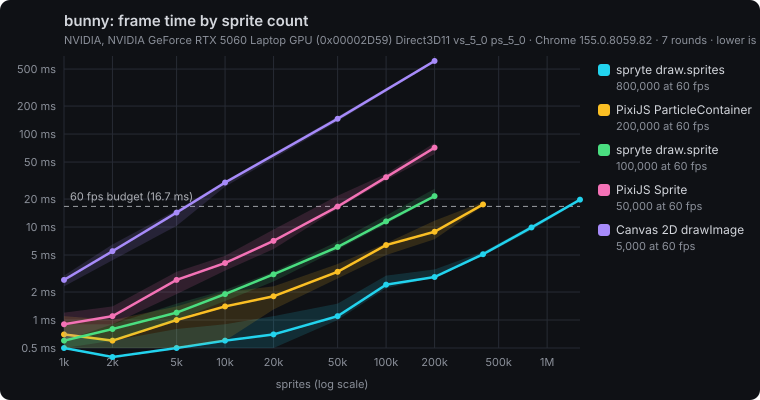

| Adapter | Version | Max at 60 fps (higher is better) | 10k (ms) | 50k (ms) | 200k (ms) |
| --- | --- | --- | --- | --- | --- |
| spryte `draw.sprites` | 0.4.2 | 800,000 | 0.5 † | 0.8 † | 2.8 |
| PixiJS `ParticleContainer` | 8.22.0 | 400,000 | 1.0 † | 3.0 | 7.5 |
| spryte `draw.sprite` | 0.4.2 | 100,000 | 1.2 † | 4.8 | 23.5 |
| Phaser `SpriteGPULayer` | 4.2.1 | 100,000 | 2.0 | 7.0 | 29.7 |
| Phaser `Blitter` | 4.2.1 | 50,000 | 2.0 | 8.0 | 38.1 |
| PixiJS `Sprite` | 8.22.0 | 50,000 | 3.6 | 14.5 | 63.2 |
| Phaser `Image` | 4.2.1 | 50,000 | 3.2 | 14.9 | 64.3 |
| Canvas 2D `drawImage` | – | 5,000 | 24.8 | 126.9 | 538.4 |

**`particles`**: one texture; position, rotation, scale, tint and alpha all change, 7 rounds

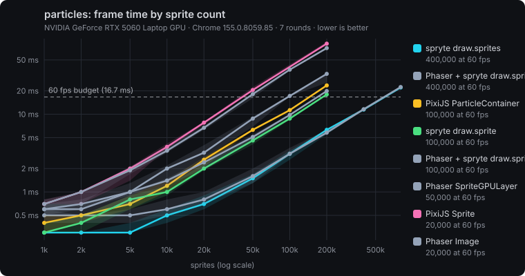

| Adapter | Version | Max at 60 fps (higher is better) | 10k (ms) | 50k (ms) | 200k (ms) |
| --- | --- | --- | --- | --- | --- |
| spryte `draw.sprites` | 0.4.2 | 400,000 | 0.6 † | 1.9 † | 6.3 |
| PixiJS `ParticleContainer` | 8.22.0 | 100,000 | 1.6 † | 6.5 | 28.9 |
| spryte `draw.sprite` | 0.4.2 | 100,000 | 1.7 † | 7.1 | 34.1 |
| Phaser `SpriteGPULayer` | 4.2.1 | 50,000 | 2.0 | 7.8 | 35.0 |
| PixiJS `Sprite` | 8.22.0 | 20,000 | 4.8 | 26.0 | 106.4 |
| Phaser `Image` | 4.2.1 | 20,000 | 4.1 | 24.3 | 95.9 |

**`mixed`**: 4 separate textures; rotation, scale, tint and alpha all change, 5 rounds

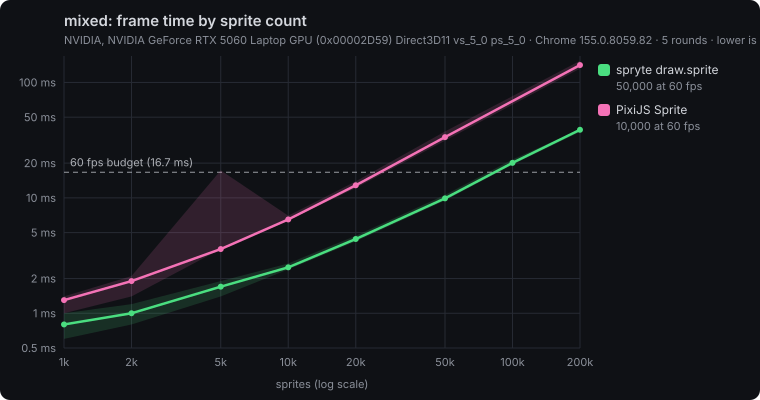

| Adapter | Version | Max at 60 fps (higher is better) | 10k (ms) | 50k (ms) | 200k (ms) |
| --- | --- | --- | --- | --- | --- |
| spryte `draw.sprite` | 0.4.2 | 100,000 | 1.9 † | 7.2 | 27.5 |
| PixiJS `Sprite` | 8.22.0 | 20,000 | 4.5 | 25.6 | 106.6 |
| Phaser `Image` | 4.2.1 | 20,000 | 4.1 | 19.5 | 100.3 |

**`raycaster`**: enemies in a first-person maze, each visible one drawn as many texture slices, 3 rounds

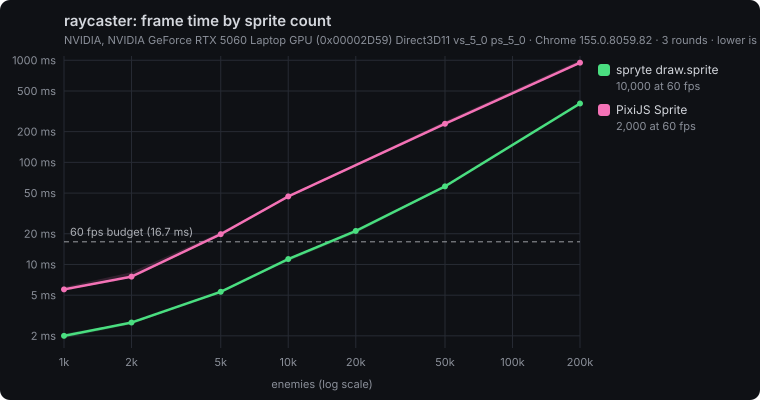

| Adapter | Version | Max enemies at 60 fps | 10k | 50k | 200k |
| --- | --- | --- | --- | --- | --- |
| spryte `draw.sprite` | 0.4.2 | 10,000 | 9.2 | 47.1 | 249.5 |
| PixiJS `Sprite` | 8.22.0 | 5,000 | 27.6 | 127.9 | 528.9 |
| Phaser `Image` | 4.2.1 | 5,000 | 24.0 | 113.2 | 398.2 |

**`tilemap`**: scrolling tile layers from one atlas, 5 rounds

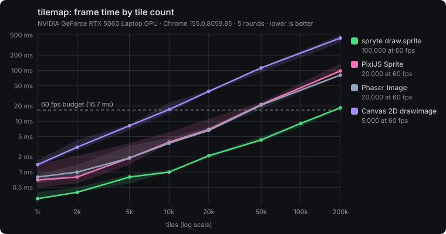

| Adapter | Version | Max tiles at 60 fps | 10k | 50k | 200k |
| --- | --- | --- | --- | --- | --- |
| spryte `draw.sprite` | 0.4.2 | 100,000 | 1.0 † | 4.3 | 18.4 |
| PixiJS `Sprite` | 8.22.0 | 20,000 | 3.9 | 21.4 | 98.2 |
| Phaser `Image` | 4.2.1 | 20,000 | 3.7 | 20.8 | 81.3 |
| Canvas 2D `drawImage` | – | 5,000 | 17.1 | 112.6 | 435.0 |

**`churn`**: every sprite lives 60 frames, so a sixtieth are destroyed and created each frame, 5 rounds

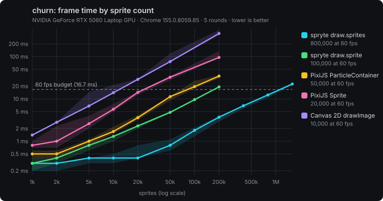

| Adapter | Version | Max at 60 fps (higher is better) | 10k (ms) | 50k (ms) | 200k (ms) |
| --- | --- | --- | --- | --- | --- |
| spryte `draw.sprites` | 0.4.2 | 800,000 | 0.4 † | 1.1 † | 3.8 |
| spryte `draw.sprite` | 0.4.2 | 100,000 | 1.6 † | 5.2 | 22.0 |
| PixiJS `ParticleContainer` | 8.22.0 | 100,000 | 2.2 | 10.6 | 34.6 |
| PixiJS `Sprite` | 8.22.0 | 20,000 | 7.3 | 34.6 | 115.6 |
| Canvas 2D `drawImage` | – | 5,000 | 23.8 | 108.8 | 474.3 |

**`text`**: a grid of numbers scrolling up, each changing every 8 frames, drawn with each library's text API, 5 rounds. The count is labels; 540 fill the screen, so this scene publishes 500, 2,000 and 5,000 and climbs to 50,000 ([why](METHOD.md#noise-and-ordering)).

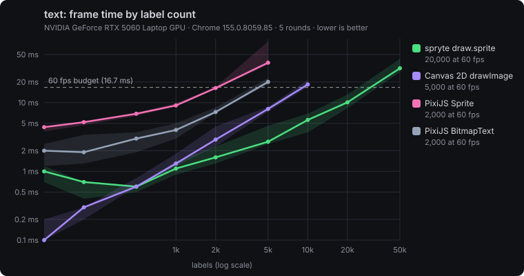

| Adapter | Version | Max labels at 60 fps | 500 | 2k | 5k |
| --- | --- | --- | --- | --- | --- |
| spryte `draw.text` | 0.4.2 | 20,000 | 0.6 † | 1.6 † | 2.7 |
| Canvas 2D `fillText` | – | 5,000 | 0.6 † | 2.9 | 8.1 |
| PixiJS `BitmapText` | 8.22.0 | 2,000 | 3.0 | 7.3 | 20.0 |
| PixiJS `Text` | 8.22.0 | 2,000 | 6.9 | 16.3 | 38.1 |

spryte packs new strings into shared atlas pages and uploads only each new rectangle, so a frame is one draw call whatever the count. PixiJS `Text` rasterises each label to its own canvas and texture, which is also why its memory grows with count (1.2 GB at 10,000 labels). `BitmapText` draws from a pre-rasterised glyph sheet. Canvas 2D `fillText` has no texture to manage at all, and is the fastest below about 800 labels.

**`lowres`**: bunnies drawn into a 480x270 target, then drawn at 2x, 5 rounds

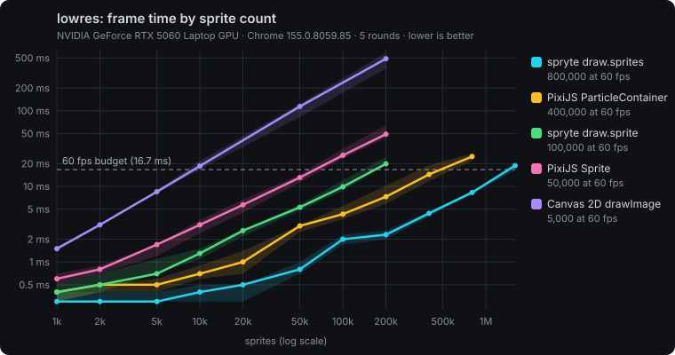

| Adapter | Version | Max at 60 fps (higher is better) | 10k (ms) | 50k (ms) | 200k (ms) |
| --- | --- | --- | --- | --- | --- |
| spryte `draw.sprites` | 0.4.2 | 800,000 | 0.4 † | 0.8 † | 2.3 |
| PixiJS `ParticleContainer` | 8.22.0 | 400,000 | 0.7 † | 3.0 | 7.3 |
| spryte `draw.sprite` | 0.4.2 | 100,000 | 1.3 † | 5.3 | 19.9 |
| PixiJS `Sprite` | 8.22.0 | 50,000 | 3.1 | 13.1 | 49.1 |
| Canvas 2D `drawImage` | – | 5,000 | 18.6 | 114.1 | 488.5 |

**`clip`**: a 4x3 grid of panels, each clipping the bunnies inside it, 5 rounds

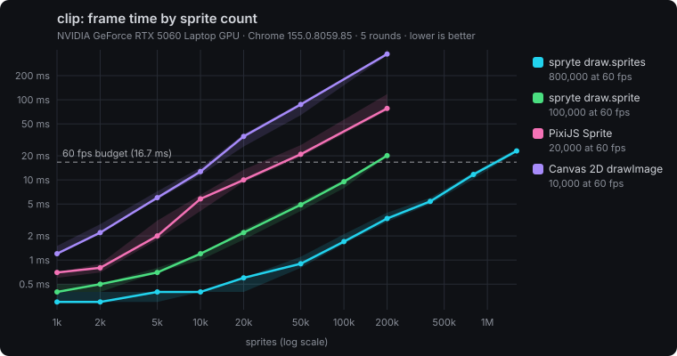

| Adapter | Version | Max at 60 fps (higher is better) | 10k (ms) | 50k (ms) | 200k (ms) |
| --- | --- | --- | --- | --- | --- |
| spryte `draw.sprites` | 0.4.2 | 800,000 | 0.4 † | 0.9 † | 3.3 |
| spryte `draw.sprite` | 0.4.2 | 100,000 | 1.2 † | 4.9 | 20.1 |
| PixiJS `Sprite` | 8.22.0 | 20,000 | 5.8 | 20.9 | 78.0 |
| Canvas 2D `drawImage` | – | 10,000 | 12.7 | 87.4 | 372.2 |

PixiJS `ParticleContainer` sits this one out: clipping would need a container per panel, which isn't measured yet.

**`upload`**: a 960x540 layer repainted on the CPU and re-uploaded every frame, under bunnies, 5 rounds

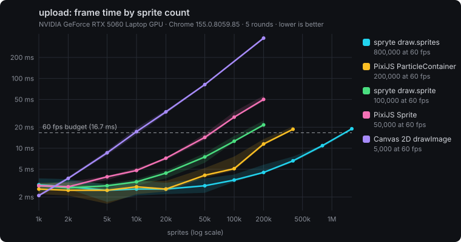

| Adapter | Version | Max at 60 fps (higher is better) | 10k (ms) | 50k (ms) | 200k (ms) |
| --- | --- | --- | --- | --- | --- |
| spryte `draw.sprites` | 0.4.2 | 800,000 | 2.4 | 2.6 | 4.8 |
| PixiJS `ParticleContainer` | 8.22.0 | 400,000 | 2.3 | 3.8 | 8.9 |
| spryte `draw.sprite` | 0.4.2 | 100,000 | 2.9 | 6.3 | 23.6 |
| PixiJS `Sprite` | 8.22.0 | 50,000 | 4.8 | 14.1 | 49.2 |
| Canvas 2D `drawImage` | – | 5,000 | 22.0 | 105.4 | 482.0 |

The upload itself costs every WebGL library about 2 ms a frame, which is the floor the bulk paths sit on at 10k.

**iPhone** (iOS 26.6.2, Chrome, which uses WebKit on iOS; Apple GPU): `mobile.html`, 1 quick round, 60 frames per count. iOS timers have 1 ms resolution, so these are indicative ([raw](results/community/2026-10-19-iphone-ios-26-chrome.json)).

| Scene | Adapter | Max at 60 fps (higher is better) | 10k (ms) | 50k (ms) | 200k (ms) |
| --- | --- | --- | --- | --- | --- |
| bunny | spryte `draw.sprites` | 400,000 | 2 | 6 | 12 |
| bunny | PixiJS `ParticleContainer` | 200,000 | 2 | 7 | 13 |
| bunny | spryte `draw.sprite` | 100,000 | 4 | 9 | 18 |
| bunny | PixiJS `Sprite` | 20,000 | 4 | 17 | – |
| bunny | Canvas 2D `drawImage` | 10,000 | 10 | – | – |
| mixed | spryte `draw.sprite` | 100,000 | 4 | 9 | 22 |
| mixed | PixiJS `Sprite` | 20,000 | 7 | 32 | – |
| particles | spryte `draw.sprites` | 200,000 | 3 | 7 | 12 |
| particles | PixiJS `ParticleContainer` | 100,000 | 3 | 9 | 28 |
| particles | spryte `draw.sprite` | 100,000 | 5 | 9 | 22 |
| particles | PixiJS `Sprite` | 20,000 | 6 | 32 | – |

On this phone, the gap closes for position-only bulk drawing (spryte `draw.sprites` and PixiJS `ParticleContainer` are level at 200k). It stays wide for general sprites (about 3.6x in `mixed` at 50k) and for dynamic particles (about 2.3x at 200k). The phone's Canvas 2D does twice as well as the desktop's.

Parity passed in every scene (desktop; checked against PixiJS `Sprite` as the reference): coverage 99.9-100.5%, and 0% of pixels differ inside sprites. The rotated scenes differ at sprite edges (9-13% of drawn pixels), where libraries round rotated corners differently. Text, under its own gate, has coverage 96-103% with 50-95% of drawn pixels differing: every library rasterises glyphs its own way. Every WebGL adapter also redrew the same frame after a lost and restored context, in 11-92 ms (PixiJS `Text` 197 ms).

**How to read these.** Compare within a table, as ratios. Absolute times depend on the machine, the day and the benchmark design (see [Statistics](METHOD.md#statistics)). One desktop GPU says little about phones, where filling pixels often dominates.

## Contestants

| Adapter | Library and API | Scenes |
| --- | --- | --- |
| `canvas2d` | Canvas 2D `drawImage`, `fillText` | every scene without per-sprite tint |
| `spryte` | spryte `draw.sprite`, `draw.text` | all |
| `spryte-bulk` | spryte `draw.sprites` | bunny, particles, churn, lowres, clip, upload |
| `pixi-sprite` | PixiJS `Sprite`, `Text` (the parity reference) | all |
| `pixi-particle` | PixiJS `ParticleContainer` | bunny, particles, churn, lowres, upload |
| `pixi-bitmaptext` | PixiJS `BitmapText` | text |
| `phaser-image` | Phaser 4 `Image` (WebGL1; Phaser has no WebGL2 option) | bunny, mixed, particles, raycaster |
| `phaser-gpulayer` | Phaser 4 `SpriteGPULayer`, every member rewritten each frame | bunny, particles |
| `phaser-blitter` | Phaser 4 `Blitter` (position only) | bunny |
| `phaser-spryte` | Phaser 4 with spryte `draw.sprite` inside an `Extern` (`spryte/phaser`, WebGL2) | bunny, mixed, particles |
| `phaser-spryte-bulk` | Phaser 4 with spryte `draw.sprites` inside an `Extern` | bunny, particles |

`raycaster` needs a different texture region per sprite. spryte `draw.sprite` and PixiJS `Sprite` do that; the bulk paths (`draw.sprites`, `ParticleContainer`) share one region per call, and Canvas 2D can't tint for the shading, so they sit this one out.

Wanted: KAPLAY, Excalibur, LittleJS, three.js, Babylon.js, melonJS, and Canvas 2D in an `OffscreenCanvas` worker. See [Adding a library](#adding-a-library).

## Scenes

| Scene | Every sprite | Measures |
| --- | --- | --- |
| `bunny` | Bounces under gravity. One texture, position only. | Raw sprite throughput: the classic bunnymark. |
| `mixed` | Also rotates, scales, and changes tint and alpha over time. Drawn from 4 separate textures. | General-purpose sprites, and multi-texture batching. |
| `particles` | Like `mixed`, from one texture. | Bulk and particle APIs with per-particle properties. |
| `tilemap` | Scrolling tile layers: an opaque ground layer with animated water, then sparse decoration layers, each scrolling at its own speed. The count is tiles drawn (2,135 per full layer). | The workload of nearly every platformer and top-down game: many small slices of one atlas, moving every frame. |
| `churn` | Every sprite lives 60 frames, so a sixtieth of them are destroyed and created each frame, and they grow as they age. | Bullets, pickups and effects. Retained-mode libraries pay for creating and destroying objects, as a game would. |
| `text` | A grid of numbers scrolling up; each changes every 8 frames and its colour every 16. Drawn with each library's native text API. The count is labels (540 fill the screen). | Scores, timers and damage numbers: text that changes often, the case that makes retained text re-rasterise. |
| `lowres` | Bunnies drawn into a 480x270 offscreen target, which is then drawn at 2x to fill the canvas. | Pixel-art games rendered at low resolution and upscaled: render targets on every frame. Post-effect shaders aren't measured, since each library's shader API differs. |
| `clip` | A 4x3 grid of UI panels, each clipping the bunnies bouncing through it. | Inventories, scrolling lists and minimaps: per-panel clipping. |
| `upload` | A 960x540 layer repainted on the CPU every frame and re-uploaded, under bunnies. | Destructible terrain, paint canvases and software effects: a full-screen texture upload per frame. |
| `raycaster` | A retro first-person maze (the Wolfenstein 3D technique): 480 textured wall slices, distance shading, and squish-blob enemies billboarded and clipped column by column. The count is the number of enemies. | Thousands of thin quads per frame, each from a different region of one texture atlas: what raycasters, sprite-sheet animation and tile atlases do. |

Every property a scene uses changes over time, so no library can win by caching values that never change. In `raycaster`, the shared simulation does all the game work (casting rays, shading, projecting and depth-clipping enemies), and adapters only draw the resulting slices. Text uses each library's own text API, so glyphs are rasterised differently. It has its own, declared parity gate: coverage within 90-110% at 100 and 540 labels, where labels don't overlap. Labels land within 1-2 pixels of each other, so it catches missing, extra or wrong labels but not pixel-exact glyphs. It also declares its own count ladder, up to 50,000 labels with 500, 2,000 and 5,000 published, because a library that keeps a texture per label needs tens of gigabytes at the default ladder's 200,000. Every run also checks **context loss**: each WebGL adapter draws a frame, the context is lost and restored, and the run records how long until the adapter draws the same frame again (or that it never did). Planned: post-effect shaders.

## Run it

**On a desktop** (Chrome or Edge):

```bash
npm install
node run.mjs                        # bunny, every adapter, 5 rounds
node run.mjs particles
node run.mjs mixed spryte pixi-sprite rounds=7
node run.mjs bunny rounds=0         # parity gate only (fast)
NOTE="Surface Laptop 5, balanced power" node run.mjs particles
```

This writes `results/<date>-<platform>-<scene>.json` ([format](docs/results.md)) and prints a markdown table. `PARITY_DUMP=1` also writes each adapter's parity frame and a diff image to `results/parity/`.

On Linux, headless Chrome falls back to software rendering (the GPU string reads "SwiftShader"). Run with a visible window instead, and keep the machine idle while it runs: `HEADED=1 node run.mjs particles`. Under Wayland, add `BROWSER_ARGS="--ozone-platform=wayland"`.

**On a phone or tablet:**

- Open **[debuffjp.github.io/2dbench/mobile.html](https://debuffjp.github.io/2dbench/mobile.html)**, fill in the device note, keep the screen on, and tap Run. Then submit the copied JSON with the [results issue template](../../issues/new?template=results.yml).
- Or serve it from your computer: run `npm run phone` and open `http://<computer's LAN IP>:4800/mobile.html`. **Send to this computer** then saves the results straight into `results/`.

## Submit your results

The more varied the devices, the more useful the data. Phones, tablets, Chromebooks, integrated GPUs, older laptops, Safari and Firefox are all wanted: they're where renderers differ most, and where most players are.

- **From a phone or any browser:** open [mobile.html](https://debuffjp.github.io/2dbench/mobile.html), type your device model, tap **Run**, then **Submit on GitHub**. It opens a pre-filled issue, and nothing is sent until you press Submit there.
- **From a desktop run:** `node submit.mjs results/<file>.json`. It validates the file, shows exactly what will be public, asks for your device model, and opens the issue with the GitHub CLI (`gh`).
- **By hand:** open a [results issue](../../issues/new?template=results.yml) and paste the JSON.

**What happens next:** a workflow checks the JSON. If it can't be accepted, it says why on the issue, and editing the issue re-runs it. If it can, the workflow commits it to `results/community/`, closes your issue and rebuilds the [community results page](https://debuffjp.github.io/2dbench/results.html), so it appears there within a couple of minutes. Validation is the gate; a file that turns out to be wrong is reverted in the open. No server or database is involved: it's all in this repository, in the open.

**What's public:** the results file, which holds timings, the browser user agent, GPU string, CPU and OS where known, and your device note, plus your GitHub username on the issue. Nothing else is collected. Results data is released under [CC0](https://creativecommons.org/publicdomain/zero/1.0/), so anyone can reuse it.

## Method, in brief

1. **Same work.** Scenes own a seeded simulation and hand every adapter the same typed arrays each frame. Adapters only draw. Same textures, 960x540, nearest filtering, no antialiasing, unrotated sprites on whole pixels.
2. **Parity gate.** Before timing, each adapter draws the same frame at 2,000 and 50,000 sprites (text: 100 and 540 labels), compared with the reference. The run fails if drawn area differs by more than 0.5%, or if more than 0.5% of pixels differ inside sprites. The inside-sprite metric is validated: a deliberately wrong tint scores 22%.
3. **Honest timing.** Each frame is timed from simulation to GPU completion (a 1-pixel readback), so vsync can't hide cost. 20 warm-up frames, then 100 measured.
4. **Statistics from evidence.** 5 interleaved rounds by default, chosen from a variance study. Medians with min-max, and every round's value kept. Low-precision cells are flagged.
5. **Full environment,** recorded automatically: GPU, browser, CPU, OS, memory, power source and plan, library versions, and the 2dbench commit.

The reasons for each choice, and the threats to validity, are in **[METHOD.md](METHOD.md)**.

## Adding a library

1. Add it to `package.json` at an exact version.
2. Write `src/adapters/<library>.ts`, implementing `Adapter` from [`src/types.ts`](src/types.ts):
   - `supports(scene)`: decline what the library can't do honestly. For example, Canvas 2D has no per-draw tint.
   - `create(canvas, textures, scene)`: set the library up the way its docs recommend for performance, and describe it in `setup`.
   - `draw(state)`: draw `state.count` sprites from the arrays, setting only the properties the scene uses.
   - `sync()`: a 1-pixel `readPixels` on the library's context.
3. Register it in [`src/adapters/index.ts`](src/adapters/index.ts), run `node run.mjs <scene> <id> rounds=0` until parity passes, then open a PR.

The adapters in `src/adapters/` are short and worth reading as examples. If you maintain a library here, please review its adapter: corrections that keep parity are merged and results rerun ([CONTRIBUTING](CONTRIBUTING.md)).

## Project

- [METHOD.md](METHOD.md): how and why it measures the way it does, statistics, and threats to validity.
- [docs/results.md](docs/results.md): every field of a results file.
- [CONTRIBUTING.md](CONTRIBUTING.md): adapter rules, maintainer review, method changes, conflicts of interest.
- [AGENTS.md](AGENTS.md): for AI agents: JSON output, fairness rules, how to propose scenarios.
- [CODE_OF_CONDUCT.md](CODE_OF_CONDUCT.md).
- CI runs the typecheck and the parity gate on every pull request (software WebGL, so correctness only).
- [Community results](https://debuffjp.github.io/2dbench/results.html): every submitted device, rebuilt on each merge.

## Licence

Code: MIT. Results data (`results/`): CC0. Library adapters use each library under its own licence.
